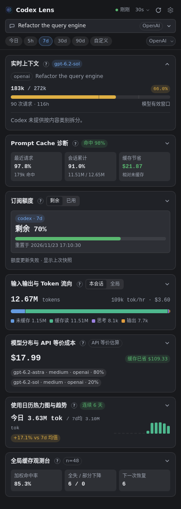

# Codex Lens

A local dashboard for Codex sessions, prompt-cache behaviour, API-equivalent cost and subscription quota. It uses the AGY Lens visual components and reads your existing Codex rollout history.

[简体中文](README.zh-CN.md) · [Data and calculation notes](docs/data.md) · [Changelog](CHANGELOG.md)

## Quick start

Install a release wheel with Python 3.11 or later:

    python -m pip install path/to/downloaded-codex_lens.whl
    codex-lens demo
    codex-lens serve

The app listens on http://127.0.0.1:4318 by default. The demo uses generated sessions and quota history. The live dashboard uses the local Codex home and optional App Server Unix socket. Use `codex-lens doctor` for a capability check and `codex-lens status --json` for a terminal summary.

For an SSH host, run the server on the host and forward the port from your desktop:

    ssh -N -L 127.0.0.1:4318:127.0.0.1:4318 your-codex-host

Open the forwarded URL in the Codex browser and use its split view. The session picker supports title, ID, and provider search. The provider filter beside the date range applies to historical analytics.

## Dashboard

- **Session** — effective context window, per-request cache trajectory, recovery markers, token flow.
- **Analytics** — provider, model, effort, workspace, date, API-equivalent cost, published Standard credit reference, activity calendar.
- **Cache Observatory** — matrix, timeline, and comparison of similarly sized requests. Turn idle and request completion intervals are separate views.
- **Quota** — ChatGPT App Server allowance snapshots and rollout backfill, cycle history, and a quantization-aware baseline estimate for attributable usage.

## Privacy and storage

The collector opens Codex rollout files for reading and sends read-only account RPCs. Only derived metrics and local session metadata go into the Lens databases. The default state directory is `~/.local/state/codex-lens`, overridable with `CODEX_LENS_STATE` or `--state`. The demo uses a temporary directory. A Linux backend with Windows browser-over-SSH is the primary deployment; Windows local file indexing works without Unix-socket collection.

Public screenshots and tests use synthetic data. The UI builds on the [AGY Lens](https://github.com/xukp20/agy-lens) MIT-licensed components. The original notice is retained in [LICENSE](LICENSE).
