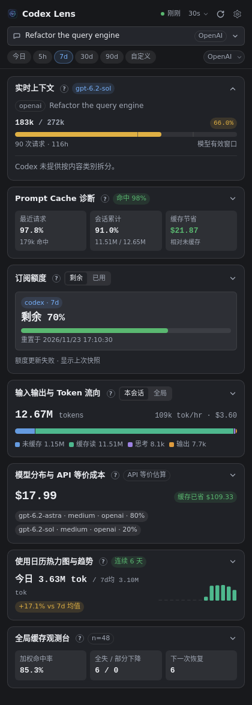

# Codex Lens

Codex 的本地用量、缓存和订阅额度看板。界面沿用 AGY Lens 的卡片、图表和设置抽屉，支持独立浏览器与 Codex 浏览器分屏。

## 安装与试用

从 GitHub Release 下载 wheel，用 Python 3.11 或更新版本安装。运行 `codex-lens demo` 查看合成数据，运行 `codex-lens serve` 连接本机记录。默认地址为 http://127.0.0.1:4318/。

远程 Linux 后端可从 Windows 转发端口：

    ssh -N -L 127.0.0.1:4318:127.0.0.1:4318 your-codex-host

在 Codex 内置浏览器打开转发后的地址，再切换到分屏。用顶部搜索定位会话，历史区可以单独切换 Provider。浏览器主题可用 `?theme=dark` 或 `?theme=light` 覆盖。

## 模块

- **会话诊断**提供上下文、Token 流向、缓存轨迹、失效与恢复。
- **用量分析**按 Provider、模型、effort、工作区和日期汇总，支持热力图与按日下钻。
- **全局缓存观测**包含矩阵、时间趋势、周期对比和脱敏报告。
- **订阅额度**使用 App Server 只读采样和 rollout 回填，按窗口展示历史及可归因区间的基础估值。
- **命令行**提供 `serve`、`demo`、`doctor` 和 `status --json`。

默认监听回环地址。派生数据和设置保存在 `~/.local/state/codex-lens`，可用 `--state` 更改。产品截图和测试使用合成数据。

[数据与计价说明](docs/data.md) · [更新记录](CHANGELOG.md) · [English](README.md)

[托管更新](docs/updates.md)
